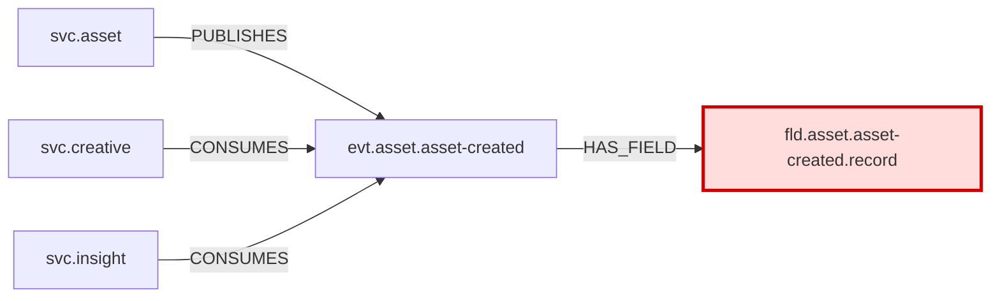

## Renaming `record` on AssetCreated affects 3 services: 2 external consumers (creative, insight) plus the owner and producer (asset)
**Risk: HIGH** (H1, H2, H3): two external services consume AssetCreated through serverless.yml rules (confidence 1.0). The field is marked PII (`id`). Insight's EventBridge rule filters on `record.sourceType`, so after the rename it stops matching and drops events without any error.

### Affected
| Node | Type | Role | Hops | Why | Tested |
|---|---|---|---|---|---|
| [[evt.asset.asset-created]] | event | owner of field | 1 | HAS_FIELD [[fld.asset.asset-created.record]] (0.8, package:asset-types) | no |
| [[svc.asset]] | service | producer (owner) | 2 | PUBLISHES [[evt.asset.asset-created]] (0.9) | yes |
| [[svc.insight]] | service | consumer (external) | 2 | CONSUMES [[evt.asset.asset-created]] (1.0); filter on `record.sourceType` | yes |
| [[svc.creative]] | service | consumer (external) | 2 | CONSUMES [[evt.asset.asset-created]] (1.0 and 0.6); filter on `record.assetType` (0.6 rule) | yes |

### Filter hits
- [[svc.insight]] (`Unite/services/insight/serverless.yml:215`, confidence 1.0): key `record.sourceType` = `[RESOURCE_MANAGER]`. This is a plain value, so after the rename the rule **stops matching**, and AssetCreated events are dropped without any error.
- [[svc.creative]] (`Unite/services/creative/serverless.yml:1874`, confidence 0.6): key `record.assetType` = `[VIDEO, {exists: false}]`. Because of `exists: false`, after the rename this key **matches every event** (the rule widens). `assetPublic.sourceType` = `[CREATIVE_EXPORT, {exists: false}]` still applies, so the handler gets unexpected invocations for non-VIDEO assets that pass that key.
- [[svc.creative]] (`Unite/services/creative/serverless.yml:1798`, confidence 1.0): filters only on `assetPublic.*`. No filter hit.

### Graph

### PII
- [[fld.asset.asset-created.record]]: `pii: true`, pii_category `id` (pii_confidence 0.6)
  - [[svc.asset]] → [[evt.asset.asset-created]] → [[svc.insight]]
  - [[svc.asset]] → [[evt.asset.asset-created]] → [[svc.creative]]

### Tests to run
No test in the vault has a TESTS edge to the field or the event. These are the tests closest to the target. They are not known to cover `record`.
- [[test.asset.svc-handlers-dynamo-router-spec]] (tests [[fn.asset.dynamo-router-handler]], the publishing handler): `npx jest Unite/services/asset/src/handlers/dynamo-router.spec.ts`
- [[test.insight.svc-eventbridge-asset-created-listener-spec]] (tests [[fn.insight.asset-created-listener-handler]]): `npx jest Unite/services/insight/src/eventbridge/asset-created-listener.spec.ts`
- [[test.creative.svc-handlers-asset-relation-events-asset-relation-events-handler-spec]] (tests [[fn.creative.asset-relation-events-handler]]): `npx jest Unite/services/creative/src/handlers/asset-relation-events/asset-relation-events-handler.spec.ts`
- [[test.creative.svc-utils-get-preview-assets-spec]] (tests [[svc.creative]]): `npx jest Unite/services/creative/src/utils/get-preview-assets.spec.ts`
- Untested: none. Every affected service has at least one test.

### Evidence
- [[evt.asset.asset-created]] HAS_FIELD [[fld.asset.asset-created.record]]: `Unite/packages/asset-types/src/index.ts:811` (0.8, package:asset-types)
- [[svc.asset]] PUBLISHES [[evt.asset.asset-created]]: `Unite/services/asset/src/handlers/dynamo-router.ts:53` (0.9, service-code)
- [[svc.insight]] CONSUMES [[evt.asset.asset-created]]: `Unite/services/insight/serverless.yml:215` (1.0, serverless.yml)
- [[svc.creative]] CONSUMES [[evt.asset.asset-created]]: `Unite/services/creative/serverless.yml:1798` (1.0, serverless.yml)
- [[svc.creative]] CONSUMES [[evt.asset.asset-created]]: `Unite/services/creative/serverless.yml:1874` (0.6, serverless.yml)

### Warnings
- The link from the event to `record` comes from the shared package asset-types (HAS_FIELD 0.8, `package:asset-types`), so it may be over-attributed.
- Creative's second rule, which is where the `record.assetType` filter hit is, has confidence 0.6 (guessed).
- The PII classification of `record` has confidence 0.6.
- A service counts as tested through tests on any of its apis or functions. The tests listed above are not known to exercise `record`.

Canvas: `_impact/rename-fld-asset-asset-created-record.canvas`
